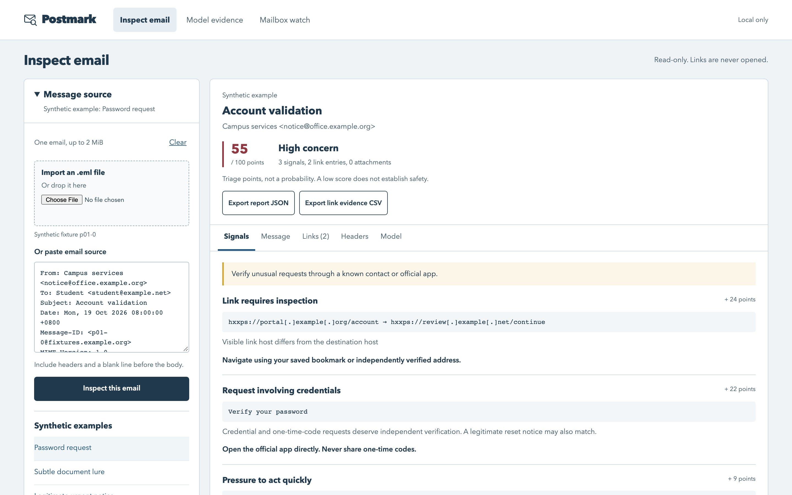
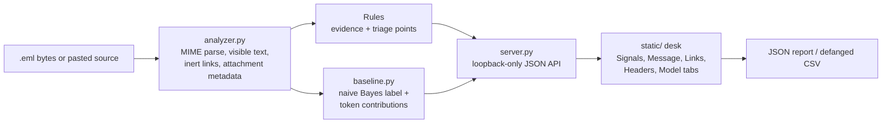
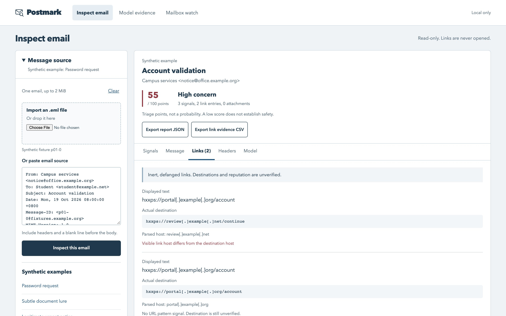
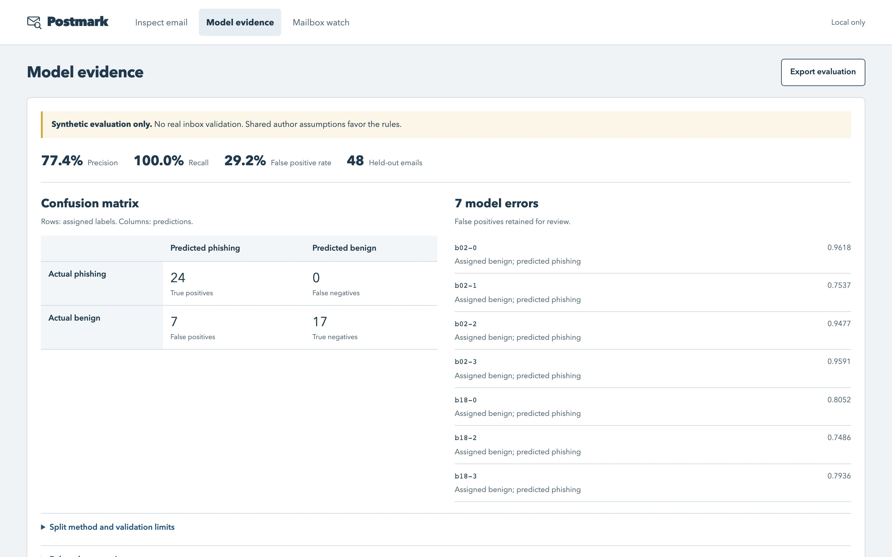
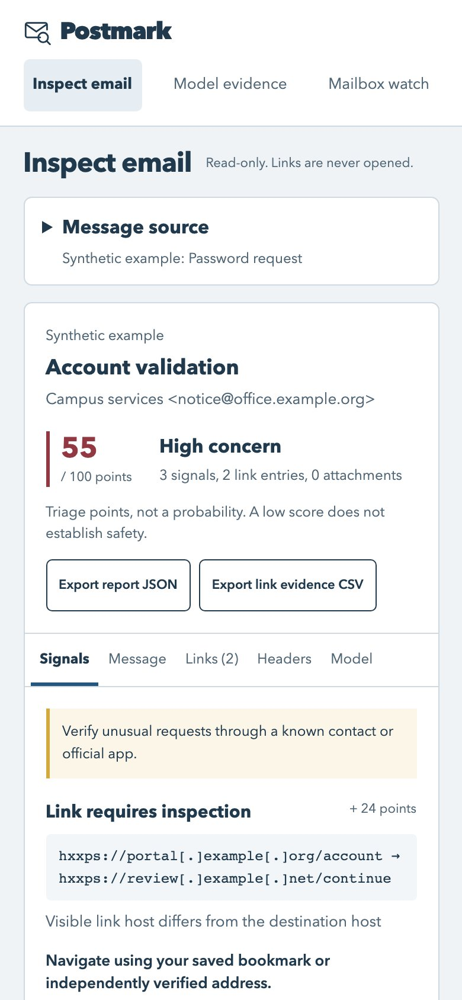

# Postmark

A local desk for inspecting a suspicious email without ever opening it. Import the original `.eml` or paste its source, and Postmark lays out the headers, MIME parts, link destinations and attachment metadata, with the reasons for each warning beside it. It is for anyone who triages reported phishing and wants evidence rather than a verdict.

 



*Not related to the commercial Postmark email delivery service.*

## What it does

- Parses the original message bytes and shows sender, reply-to, return path, received chain and authentication headers.
- Compares the link text a reader sees with the URL it actually points to. Links are shown defanged (`hxxps://portal[.]example[.]org`) and are never fetched.
- Lists attachments by name, type, size and SHA-256. It never opens or runs them.
- Explains every warning: the matched evidence, why it matters, how many points it adds, and what to check next.
- Shows a separately trained naive Bayes text model next to the rules, with its held-out mistakes on display.

## How it works



Python's own `email` parser reads the raw bytes. HTML parts are reduced to visible text by a small parser that records each `<a>` tag's text and `href`, and skips scripts, styles and remote images. A set of rules turns that evidence into findings with points; the total is a triage score capped at 100, not a probability. A naive Bayes model, trained on a separate synthetic corpus, gives its own label and the words that pushed it. The server binds only to `127.0.0.1` and has no third-party dependencies.

## Design decisions

**Keep dangerous content inert.** Nothing in the message is resolved, fetched, rendered or executed. HTML becomes text, links become defanged strings, attachments become metadata and a hash. That leaves real gaps (no redirect following, no URL reputation, no attachment scanning), but the tool can never be the thing that clicks the link.

**Treat authentication headers as claims.** SPF, DKIM and DMARC results arrive as text inside the email, and an attacker or a forwarding hop can write anything there. Postmark shows them and flags reported failures, but it does not query DNS or check signatures. A quick glossary:
- **SPF** (Sender Policy Framework): the sending domain publishes in DNS which servers may send its mail.
- **DKIM** (DomainKeys Identified Mail): the sender signs the message, and the receiver checks the signature against a public key in DNS.
- **DMARC**: the domain's policy tying SPF or DKIM to the visible From address, and saying what to do when they fail.

**Points, not probabilities.** Each rule adds a fixed weight, and repeated suspicious links are capped at 40 points so one noisy message cannot max out the score. The UI says plainly that a low score does not mean safe.

**Rules and model stay separate.** The rules are explainable but hand-written; the model learns word patterns but is uncalibrated. Combining them into one number would suggest a validated probability that does not exist, so they sit side by side.

**Evaluate against leakage and show the mistakes.** The 160 synthetic emails come in 40 families of four rewordings. Whole families go to either training or holdout, and exact token-content duplicates are merged first, so the model is never tested on a rewording of something it trained on. The seven false positives stay visible in the UI.

## Screenshots

**Links view.** The visible text says `portal.example.org`, the real destination is `review.example.net`. Both are defanged.



<table>
<tr>
<td width="68%"><strong>Model evidence.</strong> Confusion matrix on 48 held-out synthetic emails, and the seven benign messages the model wrongly flagged (password-reset and maintenance notices).<br><br></td>
<td width="32%"><strong>Phone, 390 px.</strong> After a successful inspection the source collapses and the report comes first.<br><br></td>
</tr>
</table>

## Run it

Needs Python 3.11 or newer. There are no packages to install; `requirements.txt` only records that.

```sh
git clone https://github.com/lilsallix05/phishing-email-inspector.git
cd phishing-email-inspector
python3 -m venv .venv
source .venv/bin/activate
python -m pip install -r requirements.txt   # no third-party packages
python server.py --port 8321
```

Open http://127.0.0.1:8321 and choose **Password request** under *Synthetic examples*. The server only answers on `127.0.0.1` or `localhost`. Without `--port` it uses 18766.

To see authentication-header claims, import `docs/samples/supplier-bank-change.eml`: it reports `spf=softfail` and `dmarc=fail`, and Postmark shows these as unverified.

To regenerate the model and evaluation (the output is byte-identical to the committed files):

```sh
python baseline.py
```

The optional Gmail and Microsoft Graph read-only adapters are described in [docs/MAILBOX-ADAPTERS.md](docs/MAILBOX-ADAPTERS.md). They have not been run against a live account.

## Tests

```sh
python -m unittest discover -s tests -v
```

Result on 20 October 2026, Python 3.14.6 on macOS: **25 tests, all passed**. They cover MIME parsing, hostile HTML, URL checks, the credential-phrase negation logic, the grouped split, model reproducibility, the HTTP API's host/origin/token checks and the mailbox adapters against injected responses.

`tests/browser-check.cjs` and `tests/responsive-check.cjs` are Playwright scripts for the full browser journey and layout. They need a local Playwright install and a running server (`POSTMARK_URL` sets the address) and were not re-run for this release.

## Scope

- **All data is synthetic.** The corpus was written for this project; no real inbox, public phishing feed or personal data was used.
- **The evaluation is weak by design.** On the synthetic holdout the model scored 24 true positives, 7 false positives, 17 true negatives and 0 false negatives (precision 0.77, recall 1.00). The rules scored perfectly on the same set, but they were written alongside the corpus, so that is not evidence of real-world detection.
- **Not verified:** SPF/DKIM/DMARC, URL reputation, redirects, domain ownership, image text and attachment contents.
- **Rules are English-oriented** and host comparison is exact, so a legitimate service on a different subdomain is flagged for review.
- **Next:** a consented, independently labelled real-email set with a fresh holdout grouped by campaign and time, then threshold calibration.

More detail on the build and its review fixes is in [docs/CASE-STUDY.md](docs/CASE-STUDY.md).

## Project layout

```text
analyzer.py              MIME parsing, inert link extraction, rules and scoring
baseline.py              naive Bayes training, grouped split, metrics
server.py                loopback-only HTTP server and JSON API
mail_readers.py          optional GET-only Gmail / Graph adapters and fixture watcher
static/                  index.html, app.js, style.css (no framework, no CDN)
corpus/                  160 synthetic .eml files, manifest.json, build_corpus.py
model/baseline.json      trained model
evidence/evaluation.json holdout predictions, metrics and corpus hashes
tests/                   unit tests and Playwright browser scripts
docs/                    case study, adapter notes, API sources, screenshots, extra sample
```

---

Built by Selbinyyaz (Salli) Odekova · [Portfolio](https://selbinyyaz-odekova.web.app) · MIT License
